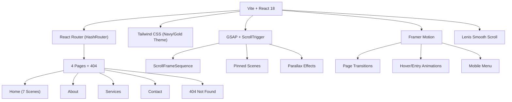

# VRP Engineering Services — Implementation Plan

## 1. Project Overview

**Client:** VRP Engineering Services, Madurai, Tamil Nadu  
**Type:** Fully static, animated, responsive marketing website  
**Stack:** React 18 + TypeScript + Vite + Tailwind CSS + GSAP + Framer Motion + Lenis

---

## 2. Architecture



## 3. File Structure

```
src/
├── components/
│   ├── layout/
│   │   ├── Header.tsx          # Sticky nav, mobile hamburger, Get a Quote btn
│   │   ├── Footer.tsx          # Footer with gopuram SVG, links, social
│   │   ├── PageTransition.tsx  # Framer Motion route transitions
│   │   ├── ScrollToTop.tsx     # Scroll reset on route change
│   │   ├── FestiveBanner.tsx   # Dismissible seasonal ribbon
│   │   └── WhatsAppButton.tsx  # Floating WhatsApp FAB
│   ├── ui/
│   │   ├── Logo.tsx            # Inline SVG logo component
│   │   ├── GopuramSilhouette.tsx # Meenakshi temple decorative SVG
│   │   ├── GoldDivider.tsx     # Gold hairline section divider
│   │   ├── AnimatedCounter.tsx # Number counter animation
│   │   ├── ServiceCard.tsx     # 3D tilt hover card
│   │   ├── TestimonialCarousel.tsx # Auto-sliding testimonials
│   │   ├── ProcessTimeline.tsx # Horizontal/vertical timeline
│   │   ├── FAQAccordion.tsx    # Expandable FAQ
│   │   └── ContactForm.tsx     # Form with validation + WhatsApp
│   ├── scenes/
│   │   ├── SceneSection.tsx    # Full-viewport scene wrapper
│   │   ├── HeroScene.tsx       # Scene 1 - Hero with video bg
│   │   ├── BlueprintScene.tsx  # Scene 2 - Scroll-scrubbed frames
│   │   ├── DTCPJourneyScene.tsx # Scene 3 - Horizontal timeline
│   │   ├── PrecisionScene.tsx  # Scene 4 - Counters + parallax
│   │   ├── OnSiteScene.tsx     # Scene 5 - Clip-path reveal
│   │   ├── ServicesPreviewScene.tsx # Scene 6 - Service cards
│   │   └── CTAScene.tsx        # Scene 7 - Testimonials + CTA
│   └── media/
│       ├── VideoBackground.tsx # Lazy video with poster fallback
│       └── ScrollFrameSequence.tsx # Canvas frame scrubber
├── pages/
│   ├── Home.tsx
│   ├── About.tsx
│   ├── Services.tsx
│   ├── Contact.tsx
│   └── NotFound.tsx
├── data/
│   ├── siteConfig.ts          # ALL business data in one file
│   └── mediaManifest.json     # Frame counts per scene
├── hooks/
│   ├── useMediaQuery.ts
│   ├── useReducedMotion.ts
│   └── useInView.ts
├── styles/
│   └── globals.css            # Tailwind directives + custom styles
├── utils/
│   ├── gsapUtils.ts           # GSAP cleanup helpers
│   └── seo.ts                 # JSON-LD schema generator
├── App.tsx
├── main.tsx
└── vite-env.d.ts

scripts/
├── process-media.sh           # Bash ffmpeg pipeline
└── process-media.mjs          # Node.js ffmpeg pipeline (Windows)

public/
├── media/
│   ├── raw/                   # Original .mp4 files (user drops here)
│   ├── video/                 # Optimized .mp4 + .webm loops
│   ├── frames/                # Frame sequences per scene
│   │   ├── blueprint-to-building/
│   │   │   ├── desktop/       # 1280px wide WebP frames
│   │   │   └── mobile/        # 720px wide WebP frames
│   │   └── ... (per scene)
│   └── posters/               # Poster .webp per clip
├── favicon.svg
├── sitemap.xml
├── robots.txt
└── 404.html                   # SPA fallback for static hosts
```

## 4. Task Breakdown

### Phase 1: Scaffold & Configuration
| # | Task | Est. |
|---|------|------|
| 1.1 | Create Vite + React + TS project | 2 min |
| 1.2 | Install all dependencies | 3 min |
| 1.3 | Configure Tailwind with navy/gold theme tokens | 5 min |
| 1.4 | Create `siteConfig.ts` with all business data | 5 min |
| 1.5 | Set up ESLint + Prettier | 3 min |
| 1.6 | Create media folder structure + placeholder manifest | 2 min |

### Phase 2: Core Layout & Navigation
| # | Task | Est. |
|---|------|------|
| 2.1 | Logo SVG component | 5 min |
| 2.2 | Header (desktop nav + mobile hamburger + drawer) | 15 min |
| 2.3 | Footer with gopuram silhouette | 10 min |
| 2.4 | HashRouter setup with all routes | 5 min |
| 2.5 | PageTransition wrapper (Framer Motion) | 5 min |
| 2.6 | ScrollToTop component | 2 min |
| 2.7 | WhatsApp floating button | 3 min |
| 2.8 | FestiveBanner (dismissible ribbon) | 5 min |
| 2.9 | Lenis smooth scroll setup | 5 min |

### Phase 3: Reusable UI Components
| # | Task | Est. |
|---|------|------|
| 3.1 | SceneSection wrapper (full-vh, dividers) | 5 min |
| 3.2 | GoldDivider + blueprint-grid transition | 3 min |
| 3.3 | VideoBackground component | 8 min |
| 3.4 | ScrollFrameSequence (canvas + GSAP) | 15 min |
| 3.5 | AnimatedCounter | 5 min |
| 3.6 | ServiceCard (3D tilt, gold glow) | 8 min |
| 3.7 | TestimonialCarousel | 8 min |
| 3.8 | ProcessTimeline (horizontal + vertical) | 8 min |
| 3.9 | FAQAccordion | 5 min |
| 3.10 | ContactForm with validation | 10 min |
| 3.11 | GopuramSilhouette SVG | 5 min |

### Phase 4: Home Page (7 Scenes)
| # | Task | Est. |
|---|------|------|
| 4.1 | HeroScene (video bg, word reveal, particles, CTA) | 15 min |
| 4.2 | BlueprintScene (scroll-scrubbed, pinned, steps) | 15 min |
| 4.3 | DTCPJourneyScene (horizontal timeline, pinned) | 12 min |
| 4.4 | PrecisionScene (counters, parallax cards) | 10 min |
| 4.5 | OnSiteScene (clip-path reveal) | 10 min |
| 4.6 | ServicesPreviewScene (cards, stagger entrance) | 8 min |
| 4.7 | CTAScene (testimonials + CTA band) | 8 min |
| 4.8 | Home page assembly | 5 min |

### Phase 5: Other Pages
| # | Task | Est. |
|---|------|------|
| 5.1 | About page (hero, story, why-us, timeline, stats) | 15 min |
| 5.2 | Services page (5 sections, FAQ) | 15 min |
| 5.3 | Contact page (form, cards, map, social) | 12 min |
| 5.4 | 404 page | 3 min |

### Phase 6: SEO, Accessibility, Performance
| # | Task | Est. |
|---|------|------|
| 6.1 | react-helmet-async: titles, metas, OG tags | 5 min |
| 6.2 | JSON-LD LocalBusiness schema | 5 min |
| 6.3 | sitemap.xml + robots.txt | 3 min |
| 6.4 | Favicon from logo | 2 min |
| 6.5 | prefers-reduced-motion handling | 5 min |
| 6.6 | Accessibility audit (aria, focus, contrast) | 5 min |
| 6.7 | Lazy loading routes + code splitting | 5 min |

### Phase 7: Media Pipeline & Placeholders
| # | Task | Est. |
|---|------|------|
| 7.1 | process-media.sh script | 8 min |
| 7.2 | process-media.mjs (Node/Windows) script | 8 min |
| 7.3 | CSS/SVG placeholder backgrounds per scene | 10 min |
| 7.4 | Generated test frame sequence | 5 min |
| 7.5 | npm run media script in package.json | 2 min |

### Phase 8: Testing & Build
| # | Task | Est. |
|---|------|------|
| 8.1 | Dev server test at multiple breakpoints | 10 min |
| 8.2 | Fix console errors, horizontal overflow | 5 min |
| 8.3 | Production build (`npm run build`) | 3 min |
| 8.4 | Preview build (`npm run preview`) | 3 min |

### Phase 9: Documentation & Delivery
| # | Task | Est. |
|---|------|------|
| 9.1 | README.md (setup, config, videos, deploy) | 8 min |
| 9.2 | Deploy instructions (Netlify, Vercel, GH Pages) | 5 min |
| 9.3 | Final summary of placeholders to replace | 3 min |

---

## 5. Design Tokens

| Token | Value | Usage |
|-------|-------|-------|
| `navy-950` | `#061033` | Deepest background |
| `navy-900` | `#0A1A4A` | Primary background |
| `navy-800` | `#0F2461` | Card/section bg |
| `navy-700` | `#142E78` | Hover states |
| `gold-500` | `#D4A62A` | Primary gold |
| `gold-400` | `#F2CB5B` | Light gold / highlights |
| `gold-600` | `#B8871A` | Dark gold / borders |
| `off-white` | `#EAEFFB` | Body text |

## 6. Animation Strategy

| Technique | Library | Scenes |
|-----------|---------|--------|
| Scroll-scrubbed frames | GSAP ScrollTrigger | 2, 5 |
| Pinned sections | GSAP ScrollTrigger | 2, 3 |
| Horizontal scroll | GSAP ScrollTrigger | 3 |
| Parallax | GSAP ScrollTrigger | 4 |
| Counter animation | GSAP / Framer | 4, About |
| Word-by-word reveal | GSAP SplitText-like | 1 |
| Page transitions | Framer Motion | All routes |
| Hover/entry animations | Framer Motion | Cards, menu |
| Smooth scroll | Lenis | Global |
| Particles/dust | Canvas / CSS | 1 |
| 3D tilt on hover | CSS transform | 6 |
| Clip-path reveal | GSAP | 5 |
| Stagger entrance | Framer Motion | 6 |

## 7. Responsive Breakpoints

| Breakpoint | Width | Key adaptations |
|------------|-------|-----------------|
| xs | 360px | Single column, vertical timeline, reduced animations |
| sm | 390px | iPhone Pro equivalent |
| md | 768px | Tablet, 2-col grids |
| lg | 1024px | Desktop nav visible |
| xl | 1280px | Max container width |
| 2xl | 1536px | Extra padding |

## 8. Risk Mitigation

> [!IMPORTANT]
> **No real videos yet** — All video/frame components will work with CSS/SVG placeholder backgrounds. Swapping requires only dropping `.mp4` files and running `npm run media`.

> [!NOTE]
> **GSAP Cleanup** — Every ScrollTrigger instance will be killed on component unmount via `useEffect` cleanup. `ScrollTrigger.refresh()` called after fonts/images load.

> [!TIP]
> **Performance** — Frame sequences lazy-loaded progressively (only visible + buffer frames). Mobile gets smaller frame sets (720px). Route-level code splitting with `React.lazy`.

---

**Proceeding to implementation →**
